# tienda_talavera

A new Flutter project.

## Getting Started

This project is a starting point for a Flutter application.

A few resources to get you started if this is your first Flutter project:

- [Learn Flutter](https://docs.flutter.dev/get-started/learn-flutter)
- [Write your first Flutter app](https://docs.flutter.dev/get-started/codelab)
- [Flutter learning resources](https://docs.flutter.dev/reference/learning-resources)

For help getting started with Flutter development, view the
[online documentation](https://docs.flutter.dev/), which offers tutorials,
samples, guidance on mobile development, and a full API reference.

## Ronda 1. Preparar el proyecto
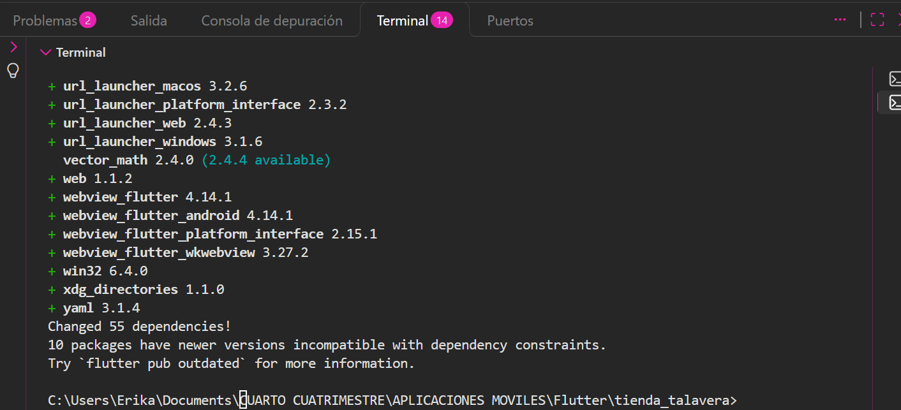

## Ronda 2. Dinero y producto
### ROJO
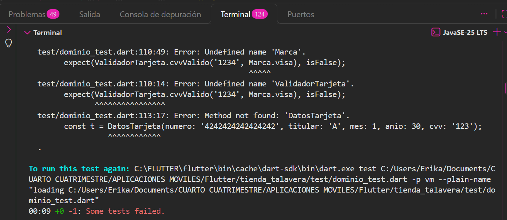

### VERDE
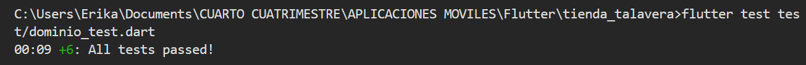

## Ronda 3. Excepciones y carrito
### ROJO
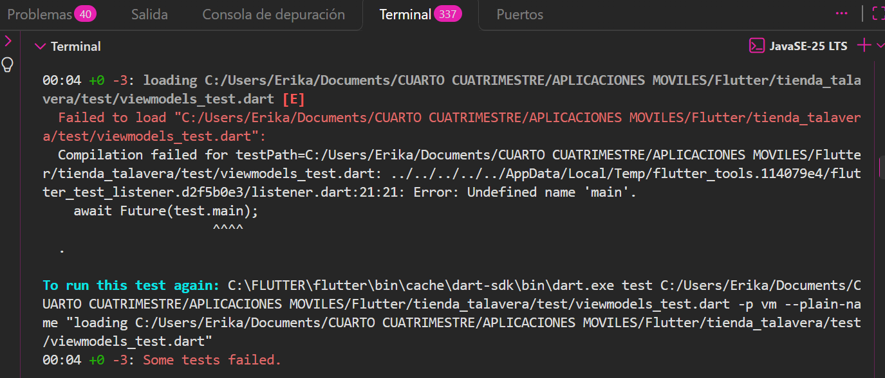

## Ronda 4. Validaciones, dirección y usuario
### ROJO
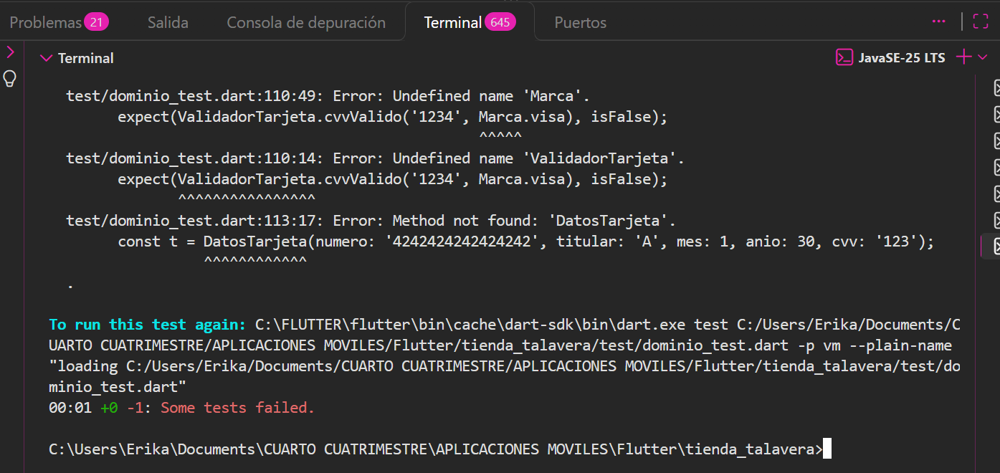

## Ronda 5. La tarjeta: Luhn, marcas y PCI
### VERDE
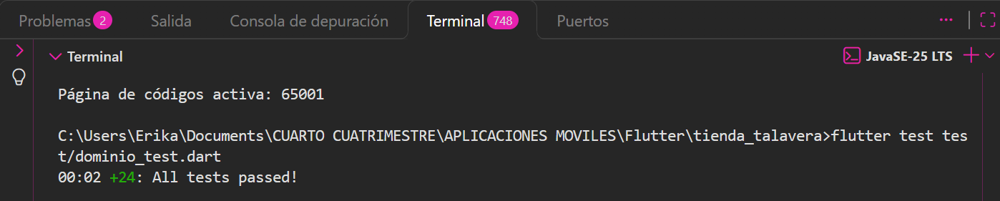

## Ronda 6. Contratos, pasarela e idempotencia
### ROJO
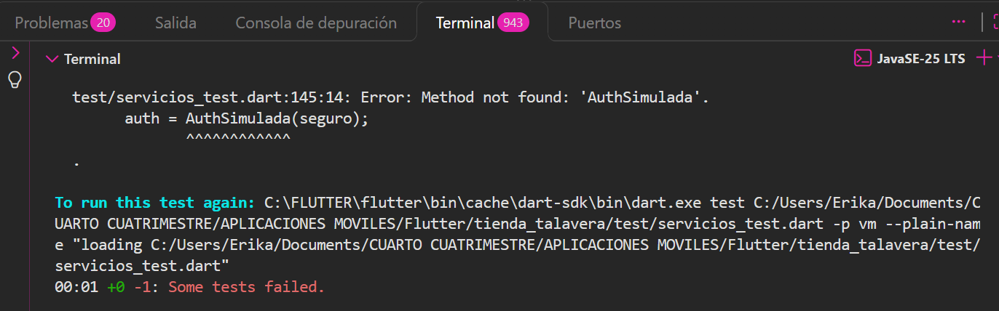

## Ronda 7. El checkout y la revalidación de precios
### VERDE
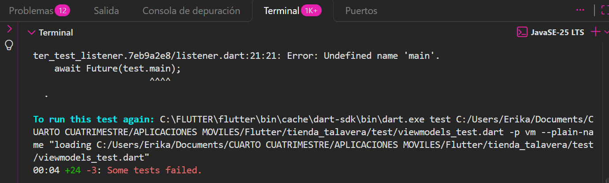

## Ronda 8. Cuentas y perfil de usuario
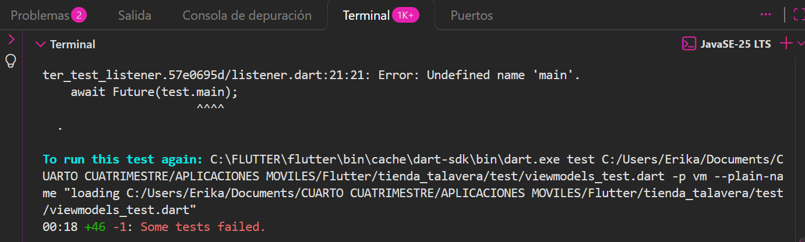

## Ronda 9. ViewModels
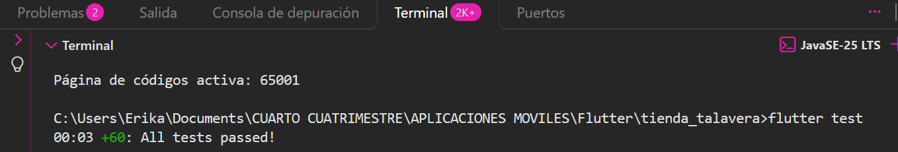

## Ronda 10. Las pantallas
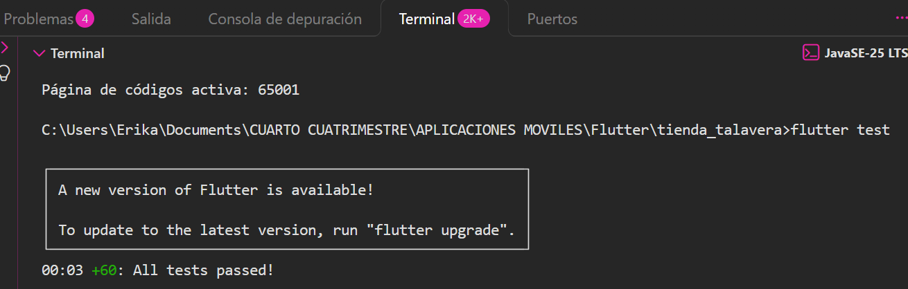

## Ronda 11. "Ver en tu espacio" con realidad aumentada
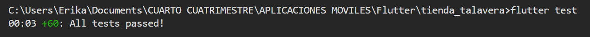

## Ronda 12. De la simulación a producción
|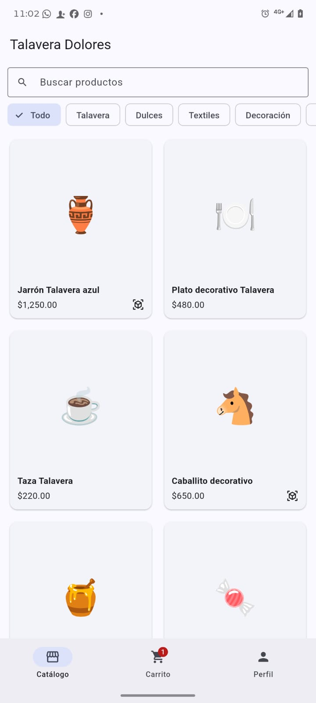|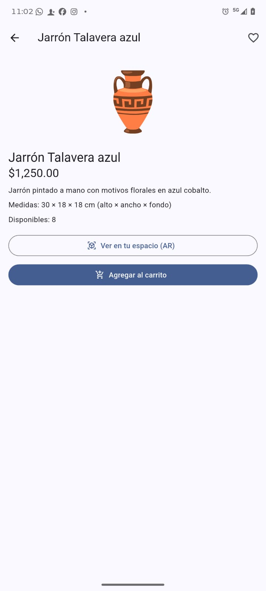|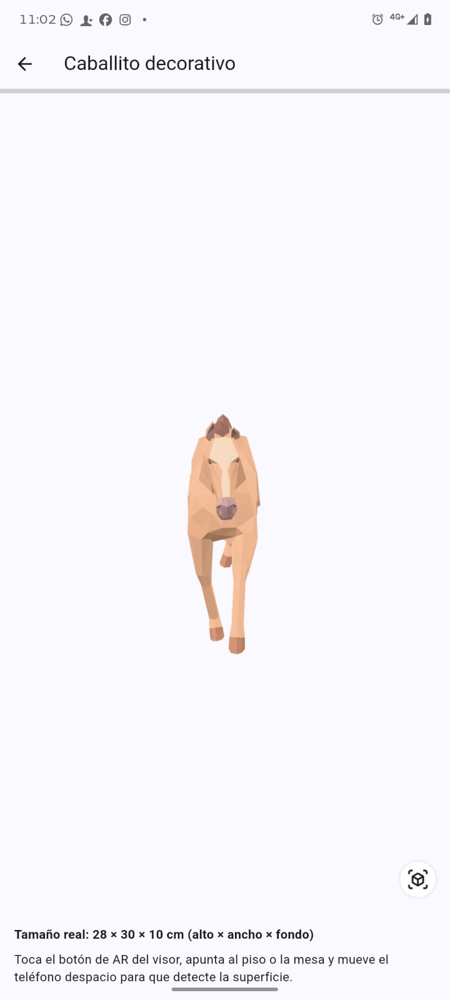|